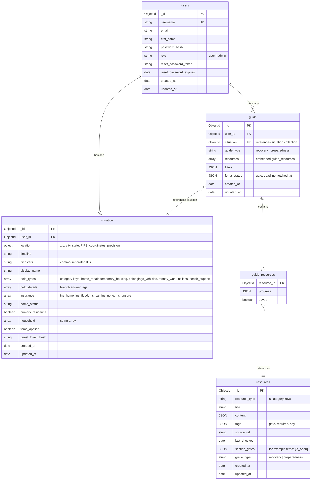
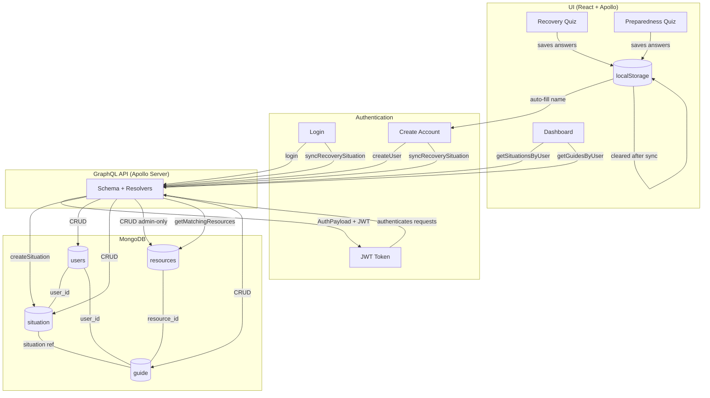

# Database Structure

MongoDB database with 4 collections, accessed via GraphQL API.

## Entity Relationship Diagram

## Data Flow

## Collection Details

### `users`
- **Auth**: password hashed with bcrypt (10 rounds), JWT token for sessions
- **Password reset**: token hashed with SHA-256, 15-min expiry
- **Constraints**: username is unique, one situation per user
- **Access**: users can only read/update their own record; admin can list all

### `situation`
- **Constraint**: one per user (enforced in resolver)
- **Created by**: synced from localStorage quiz answers after login/signup
- **Ownership**: user_id must match authenticated user

### `resources`
- **Admin-only**: only admin role can create/update/delete
- **Public read**: getResource and getResources require no auth
- **Types**: categorized by `resource_type` and `guide_type`
- **Matching**: `tags.requires` uses all-match semantics, `tags.any` uses any-match semantics, and `tags.gate` matches the user's FEMA gate.
- **Provenance**: `source_url` and `last_checked` identify the trusted source and review date.

### `guide`
- **Constraint**: one per user per guide_type (recovery or preparedness)
- **Auto-populated**: resources can be matched from the `resources` collection using the GraphQL `getMatchingResources` query and the user's tag list.
- **FEMA status**: `fema_status` stores the gate and refresh metadata used to control FEMA content.
- **Embedded subdocuments**: `resources` array contains `{resource_id, progress, saved}` entries referencing the `resources` collection
